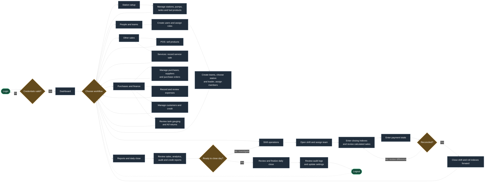
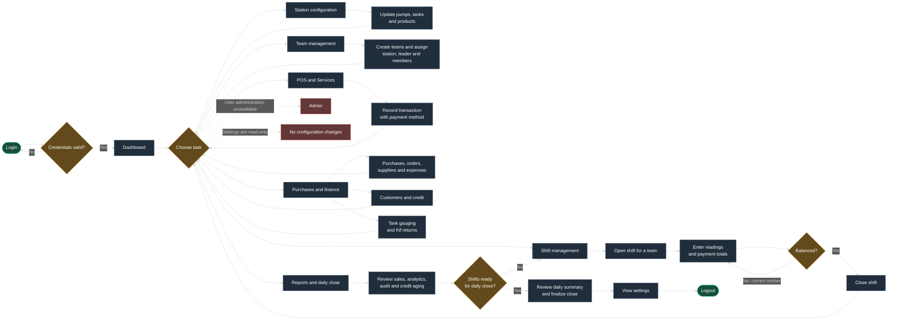
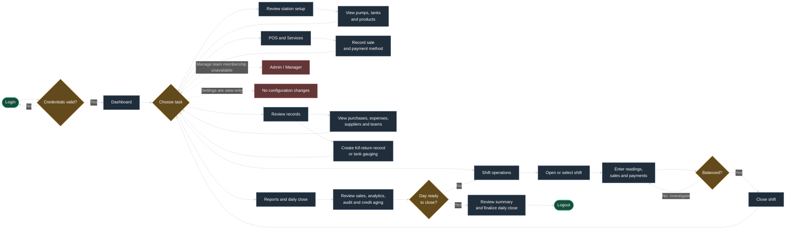
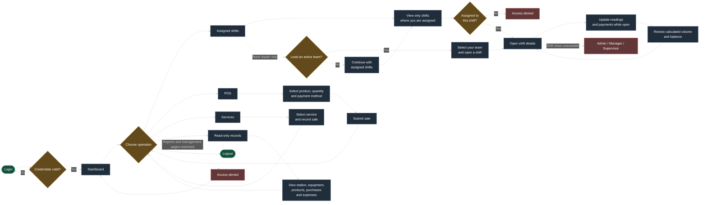

# User workflows — roles, actions, and explanations

These diagrams present the application workflows as connected action nodes: sign in, choose a task, provide the required information, and follow the result to the next step. Each diagram describes the current application, not every requirement in the station business brief.

## How to read the diagrams

- **Rounded nodes** are entry or exit points.
- **Rectangular nodes** are pages or actions.
- **Diamond nodes** are decisions or validation checks.
- **Red nodes and dotted connections** represent restricted or unavailable actions.
- A path returning to a previous node means the user should correct the data or continue working before proceeding.

The Playwright workflow suite checks role-based page access, logout, and safe interactions that do not submit or finalize transactions. See [workflows.spec.ts](../server/e2e/workflows.spec.ts) and run it with `npm --prefix server run test:e2e`. Operator-specific API/UI scenarios are in [operator-actions.spec.ts](../server/e2e/operator-actions.spec.ts); the manual Operator checklist is [operator-manual-test-checklist.md](./operator-manual-test-checklist.md).

## Admin — configure, operate, and close the station day

Admin has access to station configuration, user and team management, operational transactions, reporting, daily close, audit logs, and settings.

### Admin workflow explanation

1. **Sign in and dashboard:** authenticate with the Admin account and use the dashboard to choose an operational area.
2. **Prepare the station:** configure the station and its pumps, tanks, and products before opening shifts.
3. **Set up people:** create user accounts with the appropriate roles, then create teams and assign each team its station, leader, and members.
4. **Run a shift:** open the shift for a station and team, enter pump closing indexes, check calculated volumes and values, enter collected payments, reconcile any difference, and close the shift. Closing rolls the indexes forward.
5. **Record non-shift sales:** use POS for product sales and Services for service transactions. These are separate flows from a pump reading.
6. **Manage finance and stock records:** maintain purchases, suppliers, purchase orders, expenses, customers/credit, tank gauging, and Kif returns.
7. **Review and close the day:** examine the reports and outstanding differences before completing daily close. Finish with audit logs or settings as needed.

## Manager — manage station operations and review performance

Manager can configure station equipment and products, manage teams, operate and close shifts, manage purchases and expenses, and use operational reports and daily close. User administration is not included in this role's workflow.

### Manager workflow explanation

1. **Configure station operations:** maintain equipment and products; create teams and assign their station, leader, and members.
2. **Operate shifts:** open a shift, update readings and payments, resolve reconciliation differences, then close the shift.
3. **Record sales:** use POS or Services for transactions outside the shift close workflow.
4. **Manage purchasing and station finance:** work with purchase records/orders, suppliers, expenses, customers, and credit. Review tank gauging and Kif-return records.
5. **Review the day:** use reports to identify incomplete shifts or mismatches before daily close.
6. **Know the limits:** user-management routes are not available to Manager; settings are view-only.

## Supervisor — run shifts and monitor station activity

Supervisor can operate and close shifts, record sales, review operational records and reports, complete daily close, and record Kif returns or tank gauging. Team and settings pages are view-only.

### Supervisor workflow explanation

1. **Review operational status:** inspect station equipment, products, purchases, expenses, suppliers, and team rosters.
2. **Run shifts:** open or select the relevant shift, record pump readings and payment totals, reconcile differences, and close it.
3. **Record transactions:** use POS or Services for their respective sales workflows.
4. **Record stock-control actions:** create Kif-return and tank-gauging records using the dedicated pages.
5. **Monitor and close the day:** use reports to review sales, credit, and audit information, then complete daily close when ready.
6. **Know the limits:** Supervisor can view teams but cannot edit team membership; settings are read-only. User administration, customers UI, and purchase orders are not available through the Supervisor pages.

## Operator — work on assigned shifts and record sales

The Operator workflow is narrower and shift assignment is enforced by the API. An Operator sees and can open the detail page only for shifts where their account appears in the shift's assigned employees. When an Operator who leads an active team opens a shift, the leader and all team members are assigned automatically. Team members cannot open shifts themselves.

### Operator workflow explanation

1. **Sign in:** after authentication, use the dashboard and the operational pages allowed to the Operator role.
2. **Work only on assigned shifts:** the shifts list is filtered to shifts that explicitly contain the Operator in `employees`. The same assignment check protects direct API access to shift details and updates.
3. **Open a shift as team leader:** an Operator who is the leader of an active team can choose that team and open a shift. The shift is created with the leader and team members in its employee assignment. A regular member cannot open one.
4. **Update an assigned shift:** while the shift is open, enter closing indexes and payment totals, then check the recalculated sales and balance. Shift closure is reserved for Admin, Manager, and Supervisor.
5. **Record sales separately:** POS is for product checkout; Services is for service sales. Shift-linked fuel sales are entered from a shift detail when available.
6. **Consult records:** station, equipment, products, purchases, and expenses are read-only for Operator.
7. **Respect restricted routes:** reports, daily close, Kif returns, tank-gauging page, customer management, team management, and user/settings management are not Operator pages.

## Role access summary

| Workflow area | Admin | Manager | Supervisor | Operator |
|---|---|---|---|---|
| Stations, pumps, tanks, products | Manage | Manage | View | View |
| Users | Manage | View | Restricted | Restricted |
| Teams | Manage | Manage | View | Own active led teams only for shift opening |
| Shifts | View, open, update, close, reopen | View, open, update, close | View, open, update, close | Assigned shifts only; team leader can open own team; update readings/payments |
| POS and Services | Record sales | Record sales | Record sales | Record sales |
| Purchases and expenses | Manage | Manage | View | View |
| Suppliers and purchase orders | Manage | Manage | Supplier view; purchase orders restricted | Restricted |
| Customers / credit | Manage | Manage | Customer API permission; UI page restricted | Restricted |
| Reports and daily close | Access | Access | Access | Restricted |
| Kif returns and tank gauging | Manage | Manage | Manage | Restricted |
| Settings and audit logs | Manage / view | View | Settings view; audit page restricted | Restricted |

### Important workflow distinctions

- **A team leader's role is configurable:** the team form selects a user as leader and does not restrict leaders to a specific role. The Operator-specific shift-opening rule applies only when the logged-in user has the Operator role; the user must lead the chosen team.
- **Shift membership means explicit assignment:** opening or leading a team does not grant blanket access to all shifts. A shift is visible to an Operator only when their user ID is included in that shift's `employees`.
- **Shift close versus daily close:** shift closure finalizes that shift and rolls pump indexes forward; daily close is a separate management/supervision workflow.
- **POS versus shift sale:** POS transactions are separate sales. Use the shift detail workflow when a sale must be linked to a pump and a shift.
- **Access is enforced on both sides:** hidden controls improve usability, while server routes and handlers enforce the actual role and shift-membership rules.
