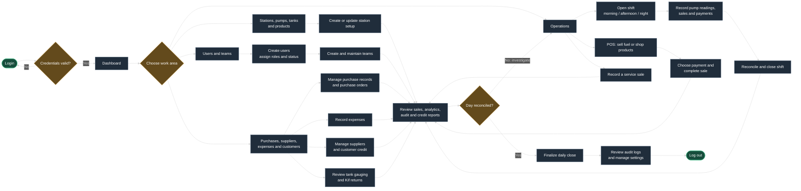
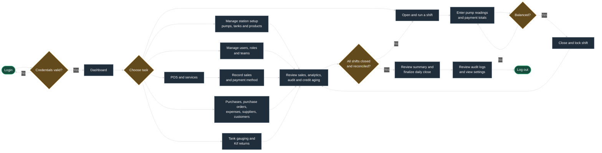
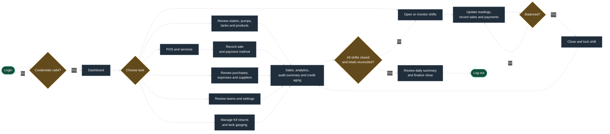
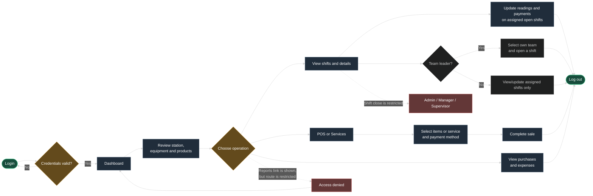

# User workflows

These diagrams map the current application actions by role. They use Mermaid flowcharts so the nodes and connections render in GitHub and in Markdown previews that support Mermaid.

Playwright smoke tests cover sign-in/out, role-based route access, denied routes, safe shift and POS interactions, role-specific purchase/expense controls, and opening/cancelling Kif-return, user, station, and daily-close screens. The suite is in [workflows.spec.ts](../server/e2e/workflows.spec.ts); run it using `npm --prefix server run test:e2e`. It uses demo accounts and never submits a data-changing form or finalizes a shift/day.

## Admin

Admin can manage the full station setup, people, operations, finance, and application settings.

## Manager

Manager follows the station operating and review workflow, including user and supplier management. Settings are read-only for this role.

## Supervisor

Supervisor focuses on operational oversight, shift reconciliation, daily close, and operational reports.

## Operator

Operators can consult operational data and record POS/service sales. Team leaders can open shifts for their own teams; every Operator sees only shifts where they are explicitly listed as an assigned employee and can update readings and payments while an assigned shift is open. Shift closure remains restricted to Admin, Manager, and Supervisor. See the [Operator manual test checklist](./operator-manual-test-checklist.md) for remaining limitations.

## Access notes

- **Reports:** the Operator navigation currently shows a Reports link, but report routes only allow Admin, Manager, and Supervisor.
- **Customers:** customer pages are restricted to Admin and Manager, even though Supervisor has a customer-read permission in the role map.
- **Teams:** Supervisor can view teams but cannot create, update, or delete them. The UI hides team write controls for that role.
- **Settings:** Admin can manage settings. Manager and Supervisor have read permission only.
- **Purchase Orders:** available to Admin and Manager; separate from the Purchases page.
- **Tank Gauging:** available to Admin, Manager, and Supervisor.
- **Purchases and Expenses:** all four roles can view these records; only Admin and Manager can create purchases or manage expenses.
- **POS versus shift sales:** POS checkout is a separate workflow. To associate a fuel sale with a pump and shift, use **Record Sale** from the shift detail page.
- **Shift close:** closing locks that shift and rolls pump indexes forward. Complete and save readings/payments before closing.
- **Operator shift access:** Operators only see shifts where their user is explicitly listed in the shift's employees. Opening a shift as leader automatically lists the leader and all team members as assigned employees. Other team members cannot open shifts. Assigned members may update readings and payments on open shifts. Closure remains restricted to Admin, Manager, and Supervisor.
